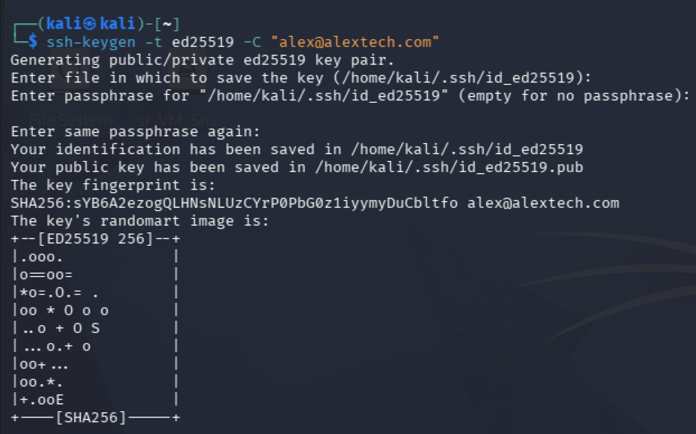
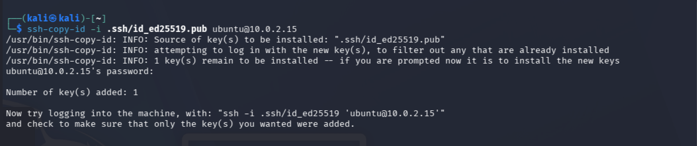
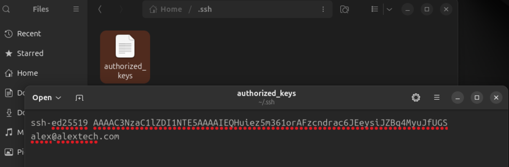
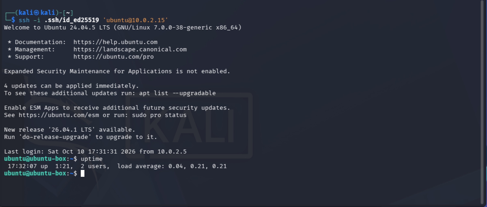
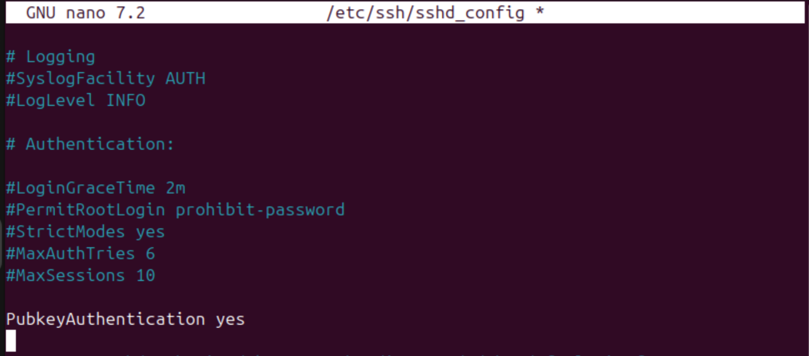
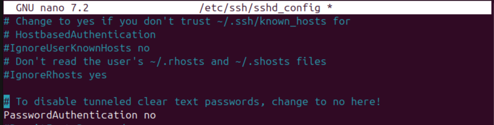
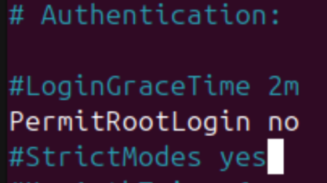
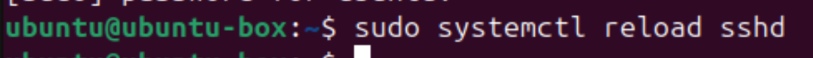
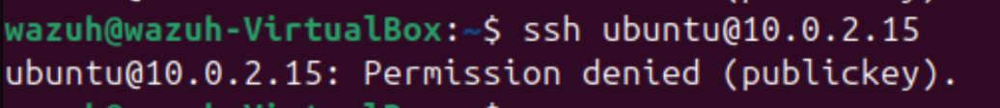

[← Back to Alex's Portfolio](https://github.com/AlexB-128)
# Wazuh SOC Lab
A lab exploring Wazuh's SIEM and XDR capabilities with an emphasis on the detection, analysis, and post-incident phases of an incident response cycle.

## Objective

Configured Wazuh SIEM/XDR server on Ubuntu with Wazuh agent configured on an Ubuntu endpoint. The purpose of this lab was to generate security related events and investigate the triggered alerts. The investigation focused on understanding how Wazuh detects abnormal/malicious activity and how logs can be used in the detection phase of incident response. Kali Linux was used to simulate these attacks on the Ubuntu endpoint. 

## Lab Environment

- Wazuh Server -> SIEM/XDR Server
- Endpoint -> Monitored Endpoint
- Wazuh Agent -> Sends endpoint data to server
- Kali -> Attacker Machine

# Investigation

### Observations

- An Nmap scan of TCP/22 did not generate a Wazuh security alert.
- An SSH connection attempt alone didn't generate a Wazuh security alert; failed authentication attempts generated multiple alerts.
     
### Actions Taken
- Reviewed and confirmed events with endpoint's /var/log/auth.log and /var/log/syslog as positive.
  
- The failed login appears to be coming from a IP 10.0.2.5.
- After discovering the IP I chose to investigate further and used Nmap to fingerprint the device, all ports appear to be in ignore states but the MAC address 08:00:27:8A:35:D2 was discovered.
   
### Conclusion
- This source device is currently unidentified and should be investigated further to determine whether it is authorized on the network.

## Generated Alerts

The attacker machine was used to launch an SSH Brute Force attack against the Ubuntu endpoint.  

- "sshd: authentication failed" (x3) - information pulled from /var/log/auth.log on Ubuntu Endpoint
Rule Level: 5 
MITRE Techniques: Password Guessing, SSH
MITRE Tactics: Credential Access, Lateral Movement

- "syslog: User missed the password more than one time"
Rule Level: 10
MITRE Techniques: Brute Force
MITRE Tactics: Credential Access

- "PAM: User login failed." 
Rule Level: 5
MITRE Techniques: Password Guessing
MITRE Tactics: Credential Access

# Remediation

To prevent SSH passwords being brute forced/guessed. Public key authentication should be implemented and password authentication should be turned off. 

### Setting up SSH key authentication

- The user attempting to connect to the SSH server must create a public/private key pair
  
- User copies their public key with the SSH server using ssh-copy-id
  
- SSH server places public key inside the authorized_keys file
  
- Before turning off password authentication we must verify we can log in with our public key
  

- Confirmed - User can now log in with their public key

### Hardening SSH Server config file

- To turn off password authentication, you must edit the sshd_config file
- sudo nano /etc/ssh/sshd_config

- Uncomment PubkeyAuthentication and set to yes
  

- Uncomment PasswordAuthentication and set to no
  

- If you don't use root login, uncomment and set PermitRootLogin to no
  
  

- Save the file
- For the changes to take effect you must restart the sshd service
  
- Verify the changes are in effect by logging into your ssh server
- Verify password authentication is disabled
  

### Other Hardening Options

- Another good idea is to edit the config file and change the default SSH port 22 to another port #.
    - Changing the default SSH port can reduce automated attacks by avoiding bots that only scan for common ports like 22. This would require additional time and resources on the attackers end to discover the port number. 
- You can also implement Fail2ban - this monitors log files and ban IP addresses that show malicious signs like repeated failed authentication attempts.
    - This can reduce the rate of incorrect authentication attempts but will not be a substitute for weak authentication mechanisms.

